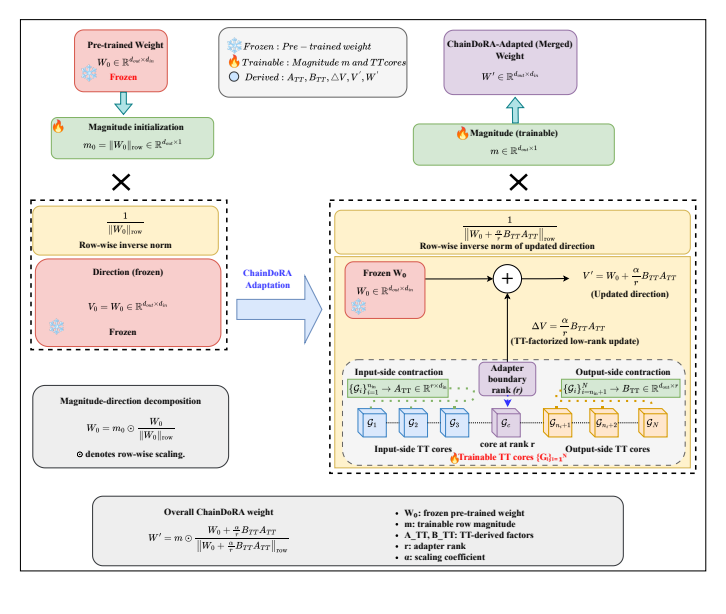
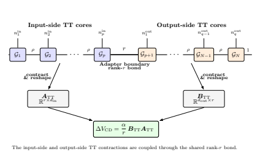
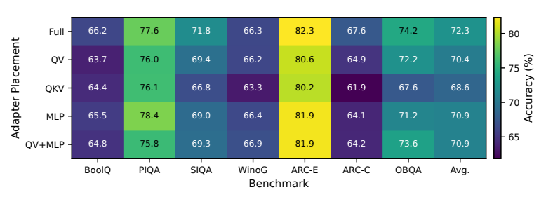

# ChainDoRA
### Tensor-Train Factorized Weight-Decomposed Low-Rank Adaptation for Parameter-Efficient LLM Fine-Tuning

**Ashfak Yeafi · Mehedi Hasan · Md Khairul Islam**

[Paper PDF](paper/paper.pdf) · [Preprint](https://doi.org/10.13140/RG.2.2.25941.18402) · [Collaborator repository](https://github.com/AshfakYeafi/Chain-DoRA) · [Results](#reported-results)

**5.35M trainable parameters · 72.30% seven-task average · 90.62% parameter reduction vs. DoRA**

*Figure 1 from the accompanying paper.*

## Overview

ChainDoRA retains DoRA's magnitude-direction decomposition while replacing its dense low-rank directional factors with factors derived from a connected Tensor-Train (TT) chain. The **adapter boundary rank r** and **internal TT rank ρ** control different aspects of the update: the former bounds the directional update rank, while the latter controls the parameter cost and capacity of the factor construction.

**Research status:** preprint; peer-reviewed acceptance is not claimed. This is Mehedi Hasan's paper-companion repository. It documents the joint work and preserves a link to [Ashfak Yeafi's existing Chain-DoRA repository](https://github.com/AshfakYeafi/Chain-DoRA); it does not replace or mirror that repository's implementation.

## Method

1. Keep the pretrained weight frozen and initialize a trainable row-wise magnitude vector.
2. Factorize input and output dimensions into small physical modes.
3. Connect input-side and output-side TT cores through a bond of rank **r**.
4. Contract those cores into A_TT and B_TT, then use their product in the DoRA directional update.
5. Optimize the TT cores and magnitude parameters; merge the adapted weights for evaluation.

*Figure 2: the connected TT construction.*

## Experimental setting

| Setting | Value |
| --- | --- |
| Backbone | LLaMA-7B |
| Adaptation pool | 15,119 examples: 14,999 optimization + 120 validation |
| Adapter rank r / scaling α | 32 / 64 |
| Main TT rank ρ | 16 |
| Target modules | Q, K, V, Up, Down across 32 layers |
| Optimizer / learning rate | AdamW / 2e-4 |
| Epochs / batch size / sequence length | 3 / 4 / 256 |
| Supervision | Response-only cross-entropy |
| Precision and memory | FP16 and gradient checkpointing |
| Evaluation | Merged weights; deterministic four-beam generation; maximum 32 new tokens |

The seven benchmarks contain **12,377 evaluation examples** in total. The headline average is the **unweighted mean of the seven task accuracies**, not pooled example accuracy. Training and evaluation settings are matched across the primary LoRA, DoRA, and ChainDoRA comparisons.

## Reported results

All results are reported in the accompanying paper and have not been independently rerun for this repository. Values are accuracy in percent.

| Method | Trainable parameters | BoolQ | PIQA | SocialIQA | WinoGrande | ARC-E | ARC-C | OBQA | Average |
| --- | ---: | ---: | ---: | ---: | ---: | ---: | ---: | ---: | ---: |
| LoRA | 56.10M | 64.83 | 72.09 | **72.47** | 65.82 | 78.03 | 62.88 | 73.00 | 69.88 |
| DoRA | 56.98M | 65.60 | 74.54 | 70.21 | 65.51 | 76.60 | 60.07 | 73.20 | 69.39 |
| **ChainDoRA** | **5.35M** | **66.24** | **77.64** | 71.80 | **66.30** | **82.32** | **67.58** | **74.20** | **72.30** |

The primary ChainDoRA configuration uses **5,346,816 trainable parameters**, compared with 56,975,360 for DoRA: **90.62% fewer** in this matched setting. Parameter savings are not equivalent to measured training-time or energy savings.

### Capacity and placement trade-offs

| Configuration | Trainable parameters (M) | Seven-task average (%) |
| --- | ---: | ---: |
| TT16, QKV + MLP | 5.347 | 72.30 |
| TT16, MLP only | 2.545 | 70.93 |
| TT8, QKV + MLP | 2.784 | 69.61 |
| TT8, MLP only | 1.383 | 68.97 |
| TT4, QKV + MLP | 1.748 | 66.05 |

*Figure 5: per-benchmark adapter-placement results.*

The paper also analyzes parameter counts for Qwen2.5, Mistral, Phi-3, OPT, and Falcon configurations spanning approximately 3B-72B parameters. **That analysis is configuration-only:** it does not train those models or establish downstream accuracy gains on them.

## Scope

The downstream experiments use one pretrained backbone and a fixed adaptation pool. The reported gains describe this controlled setting, not general superiority over LoRA/DoRA or state-of-the-art commonsense reasoning. Additional model families, larger datasets, seed replication, and contraction-kernel timing remain important extensions.

## Code availability

**Code will be available upon acceptance of the paper.** This companion repository currently provides the paper, figures, and results documentation. Follow the [collaborator repository](https://github.com/AshfakYeafi/Chain-DoRA) for the related project location.

## Reference

Ashfak Yeafi, Mehedi Hasan, and Md Khairul Islam. *ChainDoRA: Tensor-Train Factorized Weight-Decomposed Low-Rank Adaptation for Parameter-Efficient LLM Fine-Tuning*. Preprint, 2026. [DOI](https://doi.org/10.13140/RG.2.2.25941.18402).

See [figure provenance](assets/README.md). Pretrained models and benchmark datasets retain their original access and license requirements.

[Research profile](https://github.com/mhasan96) · [Website](https://sites.google.com/view/i-am-mehedi) · [Contact](mailto:hasanme1@msu.edu)
